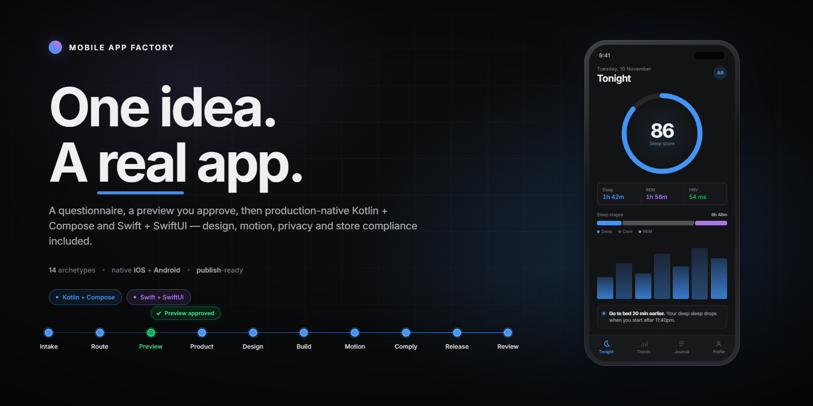
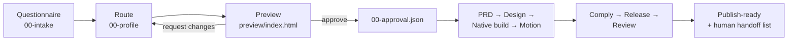
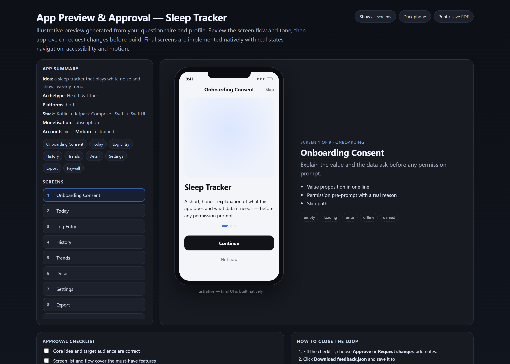

<div align="center">
  
</div>

<p align="center">
  
  
  
  
  
  <a href="https://github.com/mridungeorge/mobile-app-kit/actions/workflows/audit.yml"></a>
</p>

# Mobile App Factory

**Two skills that take an app idea from one sentence to a submitted iOS and Google Play release — native Kotlin + Jetpack Compose in Android Studio and Swift + SwiftUI in Xcode, with the design system, motion layer, privacy declarations and store compliance already in place. They are plain `SKILL.md` packages, so they run in Claude Code, OpenCode, Codex or any agent that reads a skills directory.**

You answer a questionnaire. You approve a preview. Then the pipeline takes over: product spec, design tokens, a real Gradle/Xcode project, motion, compliance, release and an adversarial review that refuses to pass with gaps it could have closed itself.

Most app launches fail on the boring half, not the code: metadata character limits, privacy manifests that do not match the SDKs actually shipped, the 12-tester Play gate that eats two weeks of calendar time. These skills front-load all of it, and they change shape depending on what you are building. A sleep tracker and a dog-walker marketplace do not get the same stack, screens, permissions or review risks just because they are both apps.

| Skill | What it does | Trigger it with |
|---|---|---|
| **`mobile-app-factory`** | Questionnaire → preview approval → PRD → design → native build → motion → store compliance → release → adversarial review | "make me an app", "Kotlin", "Jetpack Compose", "SwiftUI", "native app", "App Store", "Play Store", "12 testers", "privacy manifest", "why was my app rejected" |
| **`motion-experiences`** | Premium scroll and in-screen motion — Compose animation and SwiftUI springs on native, GSAP + React Bits on web/Capacitor, Reanimated on React Native | "add animations", "scroll effects", "premium feel", "GSAP", "React Bits" |

Both are global: they work in any project directory, and they share one design language, so an app built with the factory and animated with the motion skill looks like one product.

<div align="center">
  
  <br>
  <sub>intake → preview → approval → build, on the reference screen — <a href="motion-demo">motion-demo/</a></sub>
</div>

---

## The pipeline

Ten stages: requirements intake, deterministic routing, a preview you have to approve, then seven build-to-review phases — each with one owner, one artifact and one gate. Routing is a script, not a prompt, so the same idea always produces the same profile.

| # | Phase | Reads | Writes | Gate |
|---|---|---|---|---|
| Q | **Questionnaire** *(deterministic script)* | your idea + answers | `.mobile/00-intake.json` | Requirements captured: audience, platforms, data, permissions, money |
| 0 | **Route** *(deterministic script)* | intake + a few answers | `.mobile/00-profile.json` | Archetype chosen, stack and motion budget set |
| P | **Preview & approve** *(script + your decision)* | intake + profile | `.mobile/preview/index.html`, `.mobile/00-approval.json` | You approve, or changes are applied and re-reviewed |
| 1 | **Product** | approved profile | `.mobile/01-prd.md` | Core loop is one sentence; ≤ 12 screens |
| 2 | **Design** | PRD + profile | `.mobile/02-design.md` | Tokens, type scale, state matrix per screen |
| 3 | **Build** | design + stack | app code, `.mobile/03-build-log.md` | App runs, every screen real, no placeholder copy |
| 4 | **Motion** | build + budget | `.mobile/04-motion.md` | Entry, reveal, gesture, press states within budget |
| 5 | **Comply** | build + declarations | `.mobile/05-compliance.md`, metadata | Every field within limits, every declaration verified |
| 6 | **Release** | compliance | `.mobile/06-release.md`, CI | Signed builds for both stores, rollout plan |
| 7 | **Review** | everything | `.mobile/07-review.md` | Verdict PASS, or a blocking list routed back |



Each agent reads only the previous artifact. Decisions do not get re-litigated, and every output can be traced back to the profile that produced it.

If you already know what you are shipping, `route-idea.mjs --fast` skips the questionnaire and the preview gate, writes the same artifacts, and prints every answer it inferred so you can correct one before the build.

## Install

```bash
git clone https://github.com/mridungeorge/mobile-app-kit.git
cd mobile-app-kit
./install.sh
```

The kit is plain `SKILL.md` plus Node scripts, so the same files work in Claude Code, OpenCode, Codex or any agent that reads a skills directory. The installer copies both skills to every target it finds:

| Agent | Installed to |
|---|---|
| Claude Code | `~/.claude/skills/` |
| Codex (user scope); also read by OpenCode | `~/.agents/skills/` |
| OpenCode (own location) | `~/.config/opencode/skills/` — only when `~/.config/opencode` exists |

`--target` takes `claude`, `agents`, `opencode` or `all` and may be repeated; `--dir <path>` adds an explicit destination, and `CLAUDE_SKILLS_DIR` still overrides the Claude path. The installer restores the executable bit on the shell helpers and the Gradle wrapper, prints every destination, then runs the self-audit. It needs **Node 18+** and fails early if `node` is missing.

## Use it (end-to-end for new developers)

**1) Start with the questionnaire (requirements intake):**
```bash
node skills/mobile-app-factory/scripts/questionnaire.mjs
# writes .mobile/00-intake.json, .mobile/00-intake.md, .mobile/00-profile.json, .mobile/STATE.md
```

**2) Generate the preview and approve it** — [the commands are here](docs/preview.md). Nothing else runs until the approval file exists.

<div align="center">
  
</div>

**3) Continue the pipeline after approval** (PRD → design → native build → motion → compliance → release → review). In Claude Code, OpenCode, Codex — whichever agent you use:
> Use the **mobile-app-factory** skill. I've completed intake and approved the preview in `.mobile/`. Build **a production-ready native app** (Android: Kotlin + Jetpack Compose in Android Studio; iOS: Swift + SwiftUI in Xcode) and take it through to publish-readiness.

When the app runs, add the motion layer:
> Use the **motion-experiences** skill to add scroll and in-screen animation. Keep it premium and respect reduced motion.

> The preview is an illustrative app flow/screen approval step, not final UI. For optional concept/architecture illustrations you can also use [Anatomy](https://github.com/wheresryan22/anatomy). Store submission still requires your developer accounts, signing/CI secrets, device testing, and platform review actions.

The plain-English version is [`QUICKSTART.md`](skills/mobile-app-factory/QUICKSTART.md).

## Rebuild an app that is already live

A rebuild is a replacement, not a relaunch. The listing, installed base, subscribers and reviews stay; only the binary changes. Point the kit at the existing project and it reads what is there before planning anything:

```bash
# Read an existing Expo/React Native, Flutter, Capacitor, native iOS/Android or PWA project.
node skills/mobile-app-factory/scripts/inventory-existing.mjs --src ./existing-app --dir .mobile

# Route in rebuild mode: writes the profile and keeps the live identifiers.
node skills/mobile-app-factory/scripts/route-idea.mjs --rebuild --src ./existing-app --dir .mobile
```

The inventory records the stack, screens, navigation, SDKs with versions, API hosts and environment **names** only — never secret values. The `migration-analyst` then writes `.mobile/00-migration-plan.md` with a parity matrix (`keep` / `change` / `drop` / `add`), data migration, the API contract and a strangler cutover order.

The one rule: **update the existing listing; never create a second bundle ID or package name.** That is what preserves reviews, subscribers and the Play 12-tester gate. Signing keys, product IDs, entitlements, deep links, push channels and local data each have a continuity checklist in [`references/rebuild-existing-app.md`](skills/mobile-app-factory/references/rebuild-existing-app.md). The audit runs the inventory against [`test-fixtures/existing-expo-app`](test-fixtures/existing-expo-app) so the scanner cannot rot.

## Optional modules

The profile switches modules on per archetype; `enable-modules.mjs` copies the sources into a scaffolded app and appends their dependencies. Each module is a README, a `module.json`, platform code where it needs it, and a test artefact. The Android module code has been compiled on this machine; the iOS module sources have not — the `modules-ios` CI job would be their first compile.

| Module | What it adds | Declarations it changes |
|---|---|---|
| **billing** | One `PurchaseService` protocol over StoreKit 2 and Play Billing 7, restore purchases, an offline entitlement cache, and a RevenueCat path | Purchase history (iOS privacy manifest, Play data safety); visible Restore + manage links |
| **push** | APNs/FCM registration, a benefit-first priming screen, Android notification channels, `POST_NOTIFICATIONS` | Device ID; no promotional push without opt-in |
| **localization** | String Catalog / `strings.xml` workflow, pseudo-localization, RTL checklist, per-locale store metadata | None for privacy; every shipped locale needs its own listing fields |
| **deeplinks** | Universal Links (`apple-app-site-association`) and Android App Links (`assetlinks.json`) templates | None; the domain must be one you control |
| **analytics-crash** | A consent-gated `Analytics` protocol with a no-op default and one vendor slot | Crash Data and Performance Data; off by default for health, kids and fintech |

```bash
node skills/mobile-app-factory/scripts/enable-modules.mjs --platform android \
  --app ./myapp/android --package com.example.myapp --modules billing,push,analytics-crash
```

`reconcile-declarations.mjs` exits 1 when an SDK is in the build but missing from the declarations, so a privacy form cannot drift away from the binary.

## What this does not do

It writes the code, the specs and the declarations. It does not:

- **create store accounts** — you need an Apple Developer Program membership and a Google Play Console account
- **sign builds** — certificates, provisioning profiles and Play App Signing stay in your hands, and so do the CI secrets that use them
- **pass App Review for you** — it removes the predictable rejections (4.2 thin apps, 2.3 misleading metadata, 5.1.1 permission strings, 1.2 UGC gaps, data-safety mismatches), but a human reviewer makes the call
- **test on physical devices** — both starters build and run, but real hardware, accessibility settings and low-end performance are still yours to check
- **keep store rules current for you** — every dated Apple and Google rule lives in one file with a `verified_on` date, and you are told when it is due for re-verification

`readiness-report.mjs --strict` prints this list for your project, so the handoff is a file rather than a hope.

## Verify your install

One command, no dependencies:

```bash
node skills/mobile-app-factory/scripts/check-skill.mjs
```

Expected output — 19 checks, zero warnings, zero errors:

```
  ✓ structure: required files and all 7 agent briefs present
  ✓ frontmatter: name matches, description 912 chars
  ✓ references: 106 unique paths checked, all resolve
  ✓ archetypes: 14 match between router and reference
  ✓ store-facts: 22 dated rows sourced, verified 1 day(s) ago
  ✓ metadata template: validates clean
  ✓ router: 8/8 smoke cases classified correctly
  ✓ profiles: all archetypes emit a complete profile with ≤ 12 screens
  ✓ pipeline: intake → preview → changes → approval → readiness report
  ✓ size-budget: 2 SKILL.md under 12 KB and 300 lines, every description under 1024 chars
  ✓ licence: MIT LICENSE and NOTICE.md present
  ✓ evals: 2 skill(s) with a 50/50 trigger set and checkable quality assertions
  ✓ portability: agent adapters self-test, installer targets .claude/skills, .agents/skills, .config/opencode/skills
  ✓ fast path: --fast writes intake + profile + approved-fast with 15 assumptions, and the report prints them
  ✓ native templates: Android + iOS scaffold, substitute ids, ship the Rune motion tokens, keep the Gradle wrapper binary intact
  ✓ rebuild inventory: fixture → expo, 3 screens, 11 SDKs, API and env names only
  ✓ modules: 5 documented, manifests + tests present, router enables them, reconcile fails on undeclared SDK
  ✓ cross-platform: Expo starter files present, decision doc linked, router keeps an explicit Expo/Flutter choice
  ✓ readme: 3 referenced image(s) exist

PASS — 19 checks passed, 0 warnings, 0 errors
```

The `store-facts` line counts days since `verified_on`, so that number grows as the file ages and you get a warning at 90 days. Everything else should match; a failure names the file to fix.

The same audit runs in CI on **Linux, macOS and Windows** (`.github/workflows/audit.yml`), so a CRLF `gradlew`, a broken shell helper or a stale artwork reference fails the build instead of shipping. The same workflow compiles both native starters and the motion demo.

## Verified vs not verified

Last checked **2026-11-17**. "Verified" means the command ran on this machine; "not verified" is a real gap, not a disclaimer.

| Item | Status | Evidence |
|---|---|---|
| Skill audit (`check-skill.mjs`) | Verified | 19 checks pass, 0 warnings, 0 errors |
| Android starter `assembleDebug` | Verified | `BUILD SUCCESSFUL`, debug APK produced |
| Android starter `testDebugUnitTest` | Verified | 3/3 tests pass |
| Android starter `lintDebug` | Verified | 0 errors, 0 warnings |
| Expo starter typecheck + Android bundle | Verified | `tsc --noEmit` and `expo export --platform android` |
| Pinned dependency versions | Verified | every coordinate checked against Google Maven / Maven Central on 2026-11-16 |
| Store facts (22 dated rows) | Verified | each row carries a source URL and `verified_on: 2026-11-16` |
| iOS starter build + tests | **Not verified** | macOS-only; the `ios-build` CI job has never run |
| Module code, both platforms | Partial | Android modules (billing, push, analytics-crash) pass `assembleDebug`; the Swift sources have not been compiled |
| `modules-android`, `modules-ios`, `expo-build` CI jobs | **Not verified** | added, never run |
| Trigger evals | Verified | 2026-11-17 Codex: mobile 20/20, motion 19/20. 2026-11-16 Claude Code: mobile 18/20, motion 16/20 (before the descriptions were widened) |
| Quality evals | Partial | 2026-11-18 OpenCode (free `big-pickle`): mobile 11/19, motion 3/7. 2026-11-17 Codex: motion 0/7; mobile never finished — the first case hit the 300s limit and the Codex quota ran out |

## Automated vs. external

The factory closes every gap it can close with files and commands. Run:

```bash
node skills/mobile-app-factory/scripts/readiness-report.mjs --dir .mobile --strict
```

It checks the real artifacts and separates **AI-fixable leftovers** (missing PRD/design/motion/compliance, unvalidated metadata, missing native project, no PASS review) from **human/external actions** (developer accounts, signing material, CI secrets, real devices, store uploads, and the Google 12-tester/14-day gate). The rule the agents follow — and the handoff format — is in [`references/gap-closure.md`](skills/mobile-app-factory/references/gap-closure.md).

## Eval results

`evals/trigger.json` (20 prompts per skill: 10 that should trigger it, 10 near-misses that should not) and `evals/quality.json` (19 mobile cases, 7 motion cases with machine-checkable assertions) are run by `scripts/run-evals.mjs`, which drives a real agent CLI in a temp project holding only this kit and reports precision, recall and per-prompt pass/fail. It is not tied to one vendor: `--agent` picks `claude`, `opencode` or `codex`, `--cli-args "<command> {prompt}"` wraps any other CLI, and no API key is needed when that CLI is already signed in.

| Date | Agent | Model | Skill | Set | Result |
|---|---|---|---|---|---|
| 2026-11-16 | Claude Code | CLI default | mobile-app-factory | trigger | precision 1.0 · recall 0.8 · accuracy 0.9 (18/20) |
| 2026-11-16 | Claude Code | CLI default | motion-experiences | trigger | precision 1.0 · recall 0.6 · accuracy 0.8 (16/20) |
| 2026-11-17 | Codex CLI | gpt-6.1-sol (low) | mobile-app-factory | trigger | precision 1.0 · recall 1.0 · accuracy 1.0 (20/20) |
| 2026-11-17 | Codex CLI | gpt-6.1-sol (low) | motion-experiences | trigger | precision 0.909 · recall 1.0 · accuracy 0.95 (19/20) |
| 2026-11-17 | Codex CLI | gpt-6.1-sol (low) | motion-experiences | quality | 0/7 |
| 2026-11-17 | Codex CLI | gpt-6.1-sol (low) | mobile-app-factory | quality | not measured — quota |
| 2026-11-18 | OpenCode | big-pickle (free) | mobile-app-factory | quality | 11/19 — 11 cases hit the 300s limit, artifacts still scored |
| 2026-11-18 | OpenCode | big-pickle (free) | motion-experiences | quality | 3/7 |

The result files are committed under `skills/*/evals/results/`. The agents use different detection: Claude Code's `stream-json` output records which skill tool was called; Codex and OpenCode print text, so a run counts as triggered when its transcript contains that skill's `SKILL.md` path. A miss can therefore be a false negative on a text CLI, and a hit can be a model opening the file to check whether the skill applies. The numbers are not directly comparable across agents for that reason. OpenCode was only used for the quality sets; its trigger sets were not run.

The two 2026-11-16 Claude misses were description misses, not harness errors: "Which native stack should I use, Kotlin or Swift first?" and "Take this app idea to a shippable release plan for iOS and Android" did not fire the mobile skill; "Add reveal-on-scroll to these cards", "How do I use GSAP ScrollTrigger in React?", "My GSAP animations replay on route change" and "How do I animate list items in Jetpack Compose?" did not fire the motion skill. Both descriptions were widened after that run. The 2026-11-17 Codex run is the first measurement of the widened text: it fired on all ten mobile positives and all ten motion positives. Its one false positive is motion on "Animate this SVG logo in After Effects", which is not a supported target.

**Quality is a real gap, not a green tick.** On 2026-11-17 every motion case failed at least one named-API assertion under Codex. On 2026-11-18 a free OpenCode model passed 3 of 7 motion cases and 11 of 19 mobile cases, so the assertions are achievable but not routinely met. The mobile misses cluster in compliance-heavy work: `store-readiness`, `adaptive-ui`, `account-deletion` and both billing cases wrote prose instead of the artifact the assertion names, and `design-drift` did not use the Rune spacing scale. The motion misses are named APIs: no `useGSAP` + `matchMedia`, no `useAnimatedStyle`, and no reduce-motion branch in the budget answer. Treat the quality assertions as the next thing to fix, not as evidence that the pipeline is correct.

Two harness bugs surfaced during the 2026-11-18 run and are fixed in `run-evals.mjs`. A case that hits `--timeout` is now scored on whatever is on disk, with `timed_out: true` recorded, instead of being thrown away — eleven of the 19 mobile cases reached the 300-second limit, and eight of them had already written everything the assertions check. And a text CLI's whole transcript was being scanned for quota words, so an app design that mentioned rate limiting aborted the run; only the CLI's own last lines are checked now. `--shard i/n` splits a set for parallel runs and `--merge` reassembles the shards into one dated result.

**Both paid CLI quotas were exhausted during the 2026-11-17 run.** Claude Code returned `429 usage_limit_reached` — "You've hit your weekly limit · resets Nov 20, 1am (Australia/Sydney)"; Codex returned "You've hit your usage limit ... try again at Nov 20th, 2026 4:02 PM". The committed Claude files are the 2026-11-16 trigger-only run, so their `quality` field is `null`; the 2026-11-17 files hold the Codex numbers above. The 2026-11-18 quality runs used OpenCode's free `big-pickle` model instead, with the CLI binary invoked directly: the `.cmd` shim routes the prompt through `cmd.exe`, which truncates it at the first newline, and the model then answers the preamble instead of the case.

Re-run the quality set when a CLI has quota, on one case first:
```bash
node skills/mobile-app-factory/scripts/run-evals.mjs --quality --skill mobile-app-factory --only idea-to-prd --agent codex
```

The on-demand workflow (`.github/workflows/evals.yml`) runs the same runner under Claude Code with an `ANTHROPIC_API_KEY` secret. A run is only useful when it finishes: the runner refuses to write a results file after a quota error, so a `SKIP` or `ABORTED` line means no number, not a zero.

## Where the detail lives

This page is the tour. The long-form pages and the skill references are the manual:

- [Preview before code](docs/preview.md) — the approval gate, the 16 screen kinds, change requests
- [Routing](docs/routing.md) — the 14 archetypes and what the profile switches off
- [Native scaffold helpers](docs/native-starters.md) — what the Android and iOS starters ship
- [Design and motion language](docs/design-language.md) — tokens, type, springs, motion budget
- [What's inside](docs/whats-inside.md) — the full tree, and how to run the reference page
- [Artwork](docs/artwork.md) — how the banner, promo and preview shot are rendered
- [Store facts](skills/mobile-app-factory/references/store-facts.md) — every dated Apple and Google rule with its source URL and `verified_on` date
- [Gap closure](skills/mobile-app-factory/references/gap-closure.md) — how the agents split AI-fixable work from human handoffs

## Licence and credits

MIT — see [`LICENSE`](LICENSE). Copyright © 2026 George Mridun.

Third-party material is listed in [`NOTICE.md`](NOTICE.md): the React Bits components vendored into `motion-demo/src/components/reactbits/` (MIT + Commons Clause v1.0, © 2026 David Haz — included as an integration demo; install fresh copies in a real project with `npx shadcn@latest add @react-bits/<Component>-TS-TW`) and the Inter font used to render `docs/` (SIL OFL 1.1).

The `RESEARCH-mobile-app-2026.md` report records the store-policy research and its dates; re-verify against Apple's App Review Guidelines and Google Play's policy centre before you submit, because the dates in it will age.
