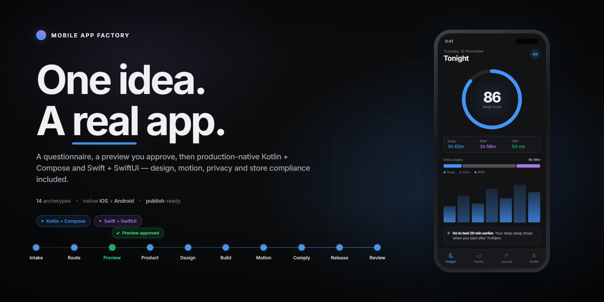
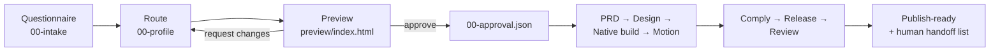
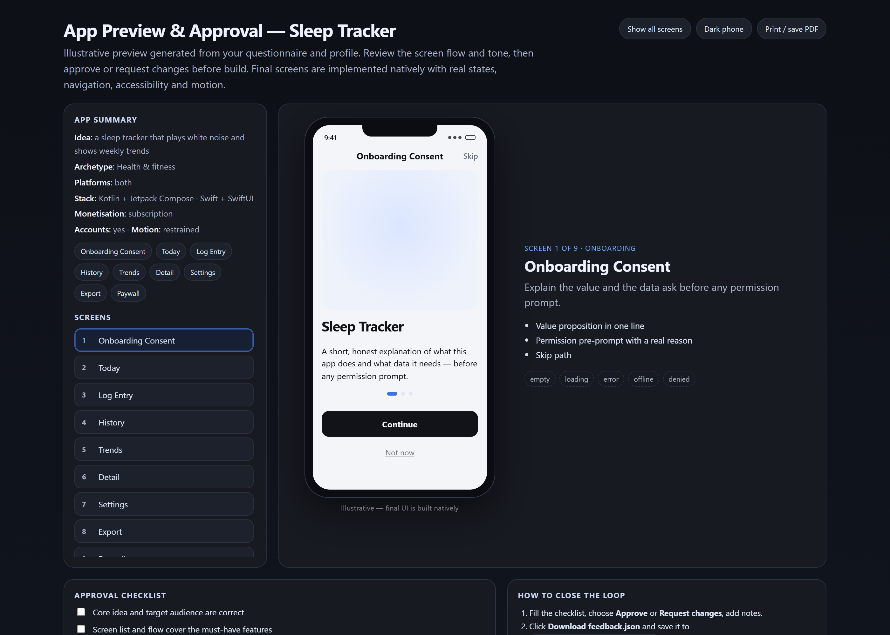

<div align="center">
  
</div>

<p align="center">
  
  
  
  
  
  <a href="https://github.com/mridungeorge/mobile-app-kit/actions/workflows/audit.yml"></a>
</p>

# Mobile App Factory

**Two Claude skills that take an app idea from one sentence to a submitted iOS and Google Play release — native Kotlin + Jetpack Compose in Android Studio and Swift + SwiftUI in Xcode, with the design system, motion layer, privacy declarations and store compliance already in place.**

You answer a questionnaire. You approve a preview. Then the pipeline takes over: product spec, design tokens, a real Gradle/Xcode project, motion, compliance, release and an adversarial review that refuses to pass with gaps it could have closed itself.

Most app launches fail on the boring half, not the code: metadata character limits, privacy manifests that do not match the SDKs actually shipped, the 12-tester Play gate that eats two weeks of calendar time. These skills front-load all of it, and they change shape depending on what you are building. A sleep tracker and a dog-walker marketplace do not get the same stack, screens, permissions or review risks just because they are both apps.

| Skill | What it does | Trigger it with |
|---|---|---|
| **`mobile-app-factory`** | Questionnaire → preview approval → PRD → design → native build → motion → store compliance → release → adversarial review | "make me an app", "Kotlin", "Jetpack Compose", "SwiftUI", "native app", "App Store", "Play Store", "12 testers", "privacy manifest", "why was my app rejected" |
| **`motion-experiences`** | Premium scroll and in-screen motion — Compose animation and SwiftUI springs on native, GSAP + React Bits on web/Capacitor, Reanimated on React Native | "add animations", "scroll effects", "premium feel", "GSAP", "React Bits" |

Both are global: they work in any project directory, and they share one design language, so an app built with the factory and animated with the motion skill looks like one product.

<div align="center">
  
  <br>
  <sub>intake → preview → approval → build, on the reference screen — <a href="motion-demo">motion-demo/</a></sub>
</div>

---

## The pipeline

Ten stages: requirements intake, deterministic routing, a preview you have to approve, then seven build-to-review phases — each with one owner, one artifact and one gate. Routing is a script, not a prompt, so the same idea always produces the same profile.

| # | Phase | Reads | Writes | Gate |
|---|---|---|---|---|
| Q | **Questionnaire** *(deterministic script)* | your idea + answers | `.mobile/00-intake.json` | Requirements captured: audience, platforms, data, permissions, money |
| 0 | **Route** *(deterministic script)* | intake + a few answers | `.mobile/00-profile.json` | Archetype chosen, stack and motion budget set |
| P | **Preview & approve** *(script + your decision)* | intake + profile | `.mobile/preview/index.html`, `.mobile/00-approval.json` | You approve, or changes are applied and re-reviewed |
| 1 | **Product** | approved profile | `.mobile/01-prd.md` | Core loop is one sentence; ≤ 12 screens |
| 2 | **Design** | PRD + profile | `.mobile/02-design.md` | Tokens, type scale, state matrix per screen |
| 3 | **Build** | design + stack | app code, `.mobile/03-build-log.md` | App runs, every screen real, no placeholder copy |
| 4 | **Motion** | build + budget | `.mobile/04-motion.md` | Entry, reveal, gesture, press states within budget |
| 5 | **Comply** | build + declarations | `.mobile/05-compliance.md`, metadata | Every field within limits, every declaration verified |
| 6 | **Release** | compliance | `.mobile/06-release.md`, CI | Signed builds for both stores, rollout plan |
| 7 | **Review** | everything | `.mobile/07-review.md` | Verdict PASS, or a blocking list routed back |



Each agent reads only the previous artifact. Decisions do not get re-litigated, and every output can be traced back to the profile that produced it.

## Preview before code

Phase P is a hard gate: no code is written until `00-approval.json` says `approved`. The preview is generated from the intake and profile — not hand-drawn — and shows the real screen inventory as illustrative phone mockups you can actually judge.

<div align="center">
  
</div>

It is a single self-contained HTML file — no server, no build:

- **16 screen kinds** rendered as plausible layouts (onboarding, auth, home, list, detail, form, settings, paywall, checkout, camera, map, chat, player, gallery, dashboard, confirmation), not grey boxes
- light/dark phone toggle, "show all screens", and print/save-to-PDF
- live controls for platform, monetisation and design direction — the profile re-routes and the preview follows
- add or remove screens and write change requests in the page itself
- an **approval checklist** that has to be filled before you can approve
- `feedback.json` export, so the decision is a file the next phase can read

```bash
node skills/mobile-app-factory/scripts/generate-preview.mjs --dir .mobile
# open .mobile/preview/index.html, fill the checklist, download feedback.json

node skills/mobile-app-factory/scripts/review-preview.mjs --dir .mobile \
  --from-feedback .mobile/preview/feedback.json

# or decide straight from the CLI
node skills/mobile-app-factory/scripts/review-preview.mjs --dir .mobile --approve
node skills/mobile-app-factory/scripts/review-preview.mjs --dir .mobile \
  --request-changes "Add settings, drop paywall" --add-screen settings --remove-screen paywall
```

Change requests update the intake **and** the profile, then regenerate the preview — so the profile and the thing you approved cannot drift apart. Every decision is appended to a history in `00-approval.json`.

## Adaptive by default

Phase 0 scores your idea against **14 archetypes** and writes the profile the whole pipeline reads:

`utility` · `health-fitness` · `social-ugc` · `commerce-marketplace` · `media` · `ai-assistant` · `fintech` · `kids-family` · `travel-maps` · `b2b-field` · `camera-photo` · `game` · `dating` · `delivery-logistics`

```bash
node skills/mobile-app-factory/scripts/route-idea.mjs \
  "a sleep tracker that plays white noise and shows weekly trends"
```

```
Archetype:   health-fitness (Health & fitness)   Confidence: high
Stack:       native — Kotlin + Jetpack Compose (Android) · Swift + SwiftUI (iOS)
Data:        Room / Core Data · Supabase
Screens:     onboarding-consent, today, log-entry, history, trends, detail,
             settings, export, paywall
Permissions: notifications, health-kit
Motion:      restrained        Age floor: 13+
Risks:       1.4.1 medical claims · 5.1.3 health data · Play health policy
```

The profile drives everything downstream — including what gets **skipped**. `accounts: false` removes auth screens and the account-deletion requirement; an empty `payments` array removes the paywall and billing QA; `ugc: false` removes report/block flows and the Apple 1.2 UGC block. Override any field by hand; the profile is an input, not a verdict.

## Install

```bash
git clone https://github.com/mridungeorge/mobile-app-kit.git
cd mobile-app-kit
./install.sh
```

The installer copies both skills into `~/.claude/skills/`, restores the executable bit on the shell helpers and the Gradle wrapper, and runs the self-audit. It needs **Node 18+** and fails early if `node` is missing. Set `CLAUDE_SKILLS_DIR` to install elsewhere.

## Use it (end-to-end for new developers)

**1) Start with the questionnaire (requirements intake):**
```bash
node skills/mobile-app-factory/scripts/questionnaire.mjs
# writes .mobile/00-intake.json, .mobile/00-intake.md, .mobile/00-profile.json, .mobile/STATE.md
```

**2) Generate the preview and approve it** — the commands above. Nothing else runs until the approval file exists.

**3) Continue the pipeline after approval** (PRD → design → native build → motion → compliance → release → review). In Claude:
> Use the **mobile-app-factory** skill. I've completed intake and approved the preview in `.mobile/`. Build **a production-ready native app** (Android: Kotlin + Jetpack Compose in Android Studio; iOS: Swift + SwiftUI in Xcode) and take it through to publish-readiness.

When the app runs, add the motion layer:
> Use the **motion-experiences** skill to add scroll and in-screen animation. Keep it premium and respect reduced motion.

> The preview is an illustrative app flow/screen approval step, not final UI. For optional concept/architecture illustrations you can also use [Anatomy](https://github.com/wheresryan22/anatomy). Store submission still requires your developer accounts, signing/CI secrets, device testing, and platform review actions.

The plain-English version is [`QUICKSTART.md`](skills/mobile-app-factory/QUICKSTART.md).

## Native production scaffold helpers

For proper native projects — not Expo Go, not a wrapper:

```bash
# Android: buildable Kotlin + Jetpack Compose project (Gradle version catalog, theme, tests)
./skills/mobile-app-factory/scripts/new-app.sh native-android "Night Notes" com.example.nightnotes

# iOS: buildable Swift + SwiftUI project (XcodeGen project.yml, PrivacyInfo, XCTest)
./skills/mobile-app-factory/scripts/new-app.sh native-ios "Night Notes" com.example.nightnotes
```

Each helper generates the actual project, not just notes: `android/` or `ios/` plus `.mobile/` state, design tokens, release/testing docs, and CI starters. Open the project in **Android Studio** / **Xcode**, or build from the command line:

```bash
cd "Night Notes/android" && ./gradlew :app:assembleDebug
cd "Night Notes/ios" && brew install xcodegen && xcodegen generate && open *.xcodeproj   # macOS
```

The Android starter ships the Gradle wrapper (`gradlew`, `gradlew.bat`, `gradle/wrapper/`), so a machine with a JDK 17 and no Gradle install can build it. It also ships a version catalog, Material 3 theme wired to the design tokens, a `HomeScreen`, unit + instrumented tests, backup rules and an adaptive icon. The iOS starter ships a `Theme.swift` mapped to the same tokens, `PrivacyInfo.xcprivacy`, an asset catalog and an XCTest target. Both substitute your app name, package and bundle id — no `__PLACEHOLDER__` tokens survive.

## Run the reference page

[`motion-demo/`](motion-demo) is a working React 19 + Vite page that exercises both skills: a GSAP hero timeline, SplitText headline, pinned scrubbed section, batched scroll reveals, count-ups, and a magnetic/spark CTA — with a full reduced-motion path.

```bash
cd motion-demo
npm install
npm run dev
```

## What's inside

```
skills/mobile-app-factory/
  SKILL.md                     pipeline, intake, preview gate, gates, definition of done
  QUICKSTART.md                idea → submission, without the jargon
  agents/01..07-*.md           7 role briefs, one per phase
  references/                  15 deep references (router, design, stores, native release,
                               testing, gap closure, orchestration, ...)
  assets/
    project-profile.template.json    hand-editable .mobile/00-profile.json
    design-tokens.json               platform-neutral tokens
    android/project/                 buildable Kotlin + Compose Gradle starter
                                     (incl. the Gradle wrapper — no Gradle install needed)
    android/data-safety-worksheet.md Play data-safety form + SDK inventory
    ios/project/                     buildable SwiftUI + XcodeGen starter
    ios/PrivacyInfo.xcprivacy        privacy manifest starter
    rn/theme.ts  rn/motion.ts        React Native tokens (prototype path only)
    rn/components/                   9 primitives: Surface, Button, ListRow,
                                     Sheet, Reveal, TextField, Switch,
                                     SegmentedControl, EmptyState
    web/tokens.css                   web / Capacitor tokens + primitives
    ci/android-release.yml           native Android CI: lint, test, signed AAB
    ci/ios-release.yml               native iOS CI: test, archive, TestFlight hook
    ci/expo-eas.json                 EAS build/submit profiles (prototype only)
    store-metadata.template.json     validates clean out of the box
  scripts/
    questionnaire.mjs                requirements intake → intake + profile + STATE
    route-idea.mjs                   deterministic idea → profile classifier
    generate-preview.mjs             illustrative preview + exportable feedback
    review-preview.mjs               change requests / approval → regenerate preview
    scaffold-native.mjs              copy native starter, substitute package/bundle id
    readiness-report.mjs             AI-fixable vs human/external gap report
    check-skill.mjs                  self-audit + end-to-end pipeline smoke test
    new-app.sh                       scaffold native Android/iOS (Expo explicit only)
    new-android-app.sh               full Android project + docs + CI starter
    new-ios-app.sh                   full iOS project + docs + Fastlane + CI starter
    validate-metadata.mjs            zero-dependency store metadata linter
  evals/prompts.md               trigger + quality test prompts

skills/motion-experiences/
  SKILL.md
  references/                    react-bits-catalog, gsap-recipes, mobile-motion
  assets/                        gsap-setup.ts, ScrollReveal.tsx
  evals/prompts.md

motion-demo/                     React 19 + Vite reference page
promo/                           source for the banner, the promo video and the preview shot
docs/                            rendered artwork
.github/workflows/audit.yml      self-audit on Linux, macOS and Windows
.gitattributes                   LF everywhere; gradlew stays executable-safe, *.bat CRLF
RESEARCH-mobile-app-2026.md      the dated research behind the store rules
install.sh                       install both skills globally
```

## Design and motion language

One language, distilled from Rune, applied across every stack:

- **Surfaces** — neutral and low-chroma. Dark `#121314` / card `#1c1d20`; light `#f0f1f4` / `#ffffff`. Depth comes from a 5–10% hairline border, not a large shadow.
- **Type** — small and tight. Body 13–14, label 12/500, section 11.5/600, negative tracking on display sizes.
- **Space** — 4 / 8 / 12 / 16 / 24. Radii 4 / 6 / 8 / 10 / 12.
- **Colour** — one accent per app, on the primary action and one data highlight. Everything else is neutral.
- **Motion** — springs, not arbitrary easing: `snap 250ms`, `settle 300ms`, `reflow 400ms`, `glide 320ms`, `morph 300ms/bounce .16`. Utilities never exceed 400ms. On native these are Compose `spring()`/`tween()` and SwiftUI `.spring(response:dampingFraction:)`; on web/Capacitor they are GSAP eases.
- **Reduce Motion** — travel is replaced with a 150ms fade. No screen is ever unreadable with animation off.

Motion is spent against a **budget** set by the profile, not a quota: `restrained` for fintech, health records, B2B and utilities; `standard` for productivity, commerce, social and travel; `expressive` for games, media, kids and camera. Expressive motion never reaches a checkout, a medical record or a data-entry form.

[`references/component-map.md`](skills/mobile-app-factory/references/component-map.md) maps every Rune component to Jetpack Compose, SwiftUI, Flutter and React Native, so the same screen spec builds anywhere instead of being re-invented per platform.

## Store compliance, dated

Apple and Google change the rules on a schedule, so the references carry effective dates rather than eternal truths. As of **November 2026**:

**Apple** — Xcode 26 / iOS 26 SDK builds (since 28 Apr 2026) · minimum deployment iOS 13 (since 9 Sep 2026) · privacy manifest + third-party SDK signatures (since May 2024) · 5-tier age ratings live 31 Jan 2026 · DSA trader status for EU distribution · digital goods must use IAP (3.1.1) · UGC apps need filtering, reporting and blocking (1.2).

**Google Play** — `targetSdk 36` for new apps and updates from 31 Aug 2026 · new personal accounts need **12 testers opted in for 14 continuous days** before production · AAB + Play App Signing · data-safety form must match actual SDK behaviour · account deletion in-app *and* a web link · IARC content rating and every App content declaration.

Budget 2–4 weeks of calendar time for the Play gate alone, and start closed testing on the first usable build rather than after polish.

## Verification

The kit audits itself — structure, references, archetypes, the full intake-to-readiness pipeline, and that both native templates scaffold cleanly:

```bash
node skills/mobile-app-factory/scripts/check-skill.mjs
```

```
  ✓ structure: required files and all 7 agent briefs present
  ✓ frontmatter: name matches, description within limits
  ✓ references: every referenced path resolves
  ✓ archetypes: 14 match between router and reference
  ✓ metadata template: validates clean
  ✓ router: 8/8 smoke cases classified correctly
  ✓ profiles: all archetypes emit a complete profile with ≤ 12 screens
  ✓ pipeline: intake → preview → changes → approval → readiness report
  ✓ native templates: Android + iOS scaffold, substitute and keep the Gradle wrapper binary intact
  ✓ readme: 3 referenced image(s) exist

PASS — 10 checks passed, 0 warnings, 0 errors
```

The same audit runs in CI on **Linux, macOS and Windows** (`.github/workflows/audit.yml`), so a CRLF `gradlew`, a broken shell helper or a stale artwork reference fails the build instead of shipping.

The store metadata linter has no dependencies and runs against real listing copy:

```bash
node skills/mobile-app-factory/scripts/validate-metadata.mjs .mobile/metadata
```

## Automated vs. external

The factory closes every gap it can close with files and commands. Run:

```bash
node skills/mobile-app-factory/scripts/readiness-report.mjs --dir .mobile --strict
```

It checks the real artifacts and separates **AI-fixable leftovers** (missing PRD/design/motion/compliance, unvalidated metadata, missing native project, no PASS review) from **human/external actions** (developer accounts, signing material, CI secrets, real devices, store uploads, and the Google 12-tester/14-day gate). The rule the agents follow — and the handoff format — is in [`skills/mobile-app-factory/references/gap-closure.md`](skills/mobile-app-factory/references/gap-closure.md).

## Artwork

The banner, the animated promo and the preview screenshot in this README are generated from source, not screenshots of a mockup. Both promo pages share [`promo/promo.css`](promo/promo.css), so the artwork and the reference page cannot drift apart.

```bash
cd promo && npm install          # puppeteer-core + ffmpeg-static, once

npm run banner                   # docs/banner.png   (1600×800)
npm run render                   # docs/promo.mp4    (1080×1350, 8.4s, H.264)
                                 # docs/poster.png   (cover frame)
                                 # docs/promo.gif    (README animation)
npm run preview-shot             # docs/preview.png  (the real generated preview page)
npm run all                      # all of the above, in order
```

The animation is rendered frame by frame from a deterministic `window.__seek(t)`, so a re-render is repeatable and a still can be checked at any beat:

```bash
npm run still                                      # promo/.build/beat.png, the approval gate
node promo/render.mjs --still 5.2 --name beat.png  # any other beat
```

`docs/preview.png` is not a mockup: `shot-preview.mjs` runs the skill's own questionnaire and preview generator into a temp directory and screenshots the result, so the README cannot advertise a preview UI that no longer exists.

Both scripts share [`promo/browser.mjs`](promo/browser.mjs) for Chrome discovery, so one environment renders everything. Chrome/Edge is auto-detected on macOS, Linux and Windows; set `CHROME_PATH` or pass `--chrome` to override:

```bash
CHROME_PATH="/path/to/chrome" node promo/render.mjs
```

| File | Size | Use |
|---|---|---|
| `docs/banner.png` | 1600×800 | README hero |
| `docs/promo.mp4` | 1080×1350, 8.4s | Instagram feed post |
| `docs/poster.png` | 1080×1350 | Post cover / carousel slide |
| `docs/promo.gif` | 720×900, 12fps | Inline README animation |
| `docs/preview.png` | 1400×1000 @2x | The real generated preview page |

## Licence and credits

MIT — see [`LICENSE`](LICENSE). Copyright © 2026 George Mridun.

Third-party material is listed in [`NOTICE.md`](NOTICE.md): the React Bits components vendored into `motion-demo/src/components/reactbits/` (MIT + Commons Clause v1.0, © 2026 David Haz — included as an integration demo; install fresh copies in a real project with `npx shadcn@latest add @react-bits/<Component>-TS-TW`) and the Inter font used to render `docs/` (SIL OFL 1.1).

The `RESEARCH-mobile-app-2026.md` report records the store-policy research and its dates; re-verify against Apple's App Review Guidelines and Google Play's policy centre before you submit, because the dates in it will age.
