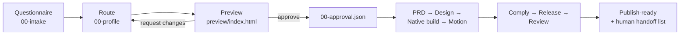

<div align="center">
  
</div>

<p align="center">
  
  
  
  
  
  <a href="https://github.com/mridungeorge/mobile-app-kit/actions/workflows/audit.yml"></a>
</p>

# Mobile App Factory

**Two Claude skills that take an app idea from one sentence to a submitted iOS and Google Play release — native Kotlin + Jetpack Compose in Android Studio and Swift + SwiftUI in Xcode, with the design system, motion layer, privacy declarations and store compliance already in place.**

You answer a questionnaire. You approve a preview. Then the pipeline takes over: product spec, design tokens, a real Gradle/Xcode project, motion, compliance, release and an adversarial review that refuses to pass with gaps it could have closed itself.

Most app launches fail on the boring half, not the code: metadata character limits, privacy manifests that do not match the SDKs actually shipped, the 12-tester Play gate that eats two weeks of calendar time. These skills front-load all of it, and they change shape depending on what you are building. A sleep tracker and a dog-walker marketplace do not get the same stack, screens, permissions or review risks just because they are both apps.

| Skill | What it does | Trigger it with |
|---|---|---|
| **`mobile-app-factory`** | Questionnaire → preview approval → PRD → design → native build → motion → store compliance → release → adversarial review | "make me an app", "Kotlin", "Jetpack Compose", "SwiftUI", "native app", "App Store", "Play Store", "12 testers", "privacy manifest", "why was my app rejected" |
| **`motion-experiences`** | Premium scroll and in-screen motion — Compose animation and SwiftUI springs on native, GSAP + React Bits on web/Capacitor, Reanimated on React Native | "add animations", "scroll effects", "premium feel", "GSAP", "React Bits" |

Both are global: they work in any project directory, and they share one design language, so an app built with the factory and animated with the motion skill looks like one product.

<div align="center">
  
  <br>
  <sub>intake → preview → approval → build, on the reference screen — <a href="motion-demo">motion-demo/</a></sub>
</div>

---

## The pipeline

Ten stages: requirements intake, deterministic routing, a preview you have to approve, then seven build-to-review phases — each with one owner, one artifact and one gate. Routing is a script, not a prompt, so the same idea always produces the same profile.

| # | Phase | Reads | Writes | Gate |
|---|---|---|---|---|
| Q | **Questionnaire** *(deterministic script)* | your idea + answers | `.mobile/00-intake.json` | Requirements captured: audience, platforms, data, permissions, money |
| 0 | **Route** *(deterministic script)* | intake + a few answers | `.mobile/00-profile.json` | Archetype chosen, stack and motion budget set |
| P | **Preview & approve** *(script + your decision)* | intake + profile | `.mobile/preview/index.html`, `.mobile/00-approval.json` | You approve, or changes are applied and re-reviewed |
| 1 | **Product** | approved profile | `.mobile/01-prd.md` | Core loop is one sentence; ≤ 12 screens |
| 2 | **Design** | PRD + profile | `.mobile/02-design.md` | Tokens, type scale, state matrix per screen |
| 3 | **Build** | design + stack | app code, `.mobile/03-build-log.md` | App runs, every screen real, no placeholder copy |
| 4 | **Motion** | build + budget | `.mobile/04-motion.md` | Entry, reveal, gesture, press states within budget |
| 5 | **Comply** | build + declarations | `.mobile/05-compliance.md`, metadata | Every field within limits, every declaration verified |
| 6 | **Release** | compliance | `.mobile/06-release.md`, CI | Signed builds for both stores, rollout plan |
| 7 | **Review** | everything | `.mobile/07-review.md` | Verdict PASS, or a blocking list routed back |



Each agent reads only the previous artifact. Decisions do not get re-litigated, and every output can be traced back to the profile that produced it.

If you already know what you are shipping, `route-idea.mjs --fast` skips the questionnaire and the preview gate, writes the same artifacts, and prints every answer it inferred so you can correct one before the build.

## Install

```bash
git clone https://github.com/mridungeorge/mobile-app-kit.git
cd mobile-app-kit
./install.sh
```

The installer copies both skills into `~/.claude/skills/`, restores the executable bit on the shell helpers and the Gradle wrapper, and runs the self-audit. It needs **Node 18+** and fails early if `node` is missing. Set `CLAUDE_SKILLS_DIR` to install elsewhere.

## Use it (end-to-end for new developers)

**1) Start with the questionnaire (requirements intake):**
```bash
node skills/mobile-app-factory/scripts/questionnaire.mjs
# writes .mobile/00-intake.json, .mobile/00-intake.md, .mobile/00-profile.json, .mobile/STATE.md
```

**2) Generate the preview and approve it** — [the commands are here](docs/preview.md). Nothing else runs until the approval file exists.

<div align="center">
  
</div>

**3) Continue the pipeline after approval** (PRD → design → native build → motion → compliance → release → review). In Claude:
> Use the **mobile-app-factory** skill. I've completed intake and approved the preview in `.mobile/`. Build **a production-ready native app** (Android: Kotlin + Jetpack Compose in Android Studio; iOS: Swift + SwiftUI in Xcode) and take it through to publish-readiness.

When the app runs, add the motion layer:
> Use the **motion-experiences** skill to add scroll and in-screen animation. Keep it premium and respect reduced motion.

> The preview is an illustrative app flow/screen approval step, not final UI. For optional concept/architecture illustrations you can also use [Anatomy](https://github.com/wheresryan22/anatomy). Store submission still requires your developer accounts, signing/CI secrets, device testing, and platform review actions.

The plain-English version is [`QUICKSTART.md`](skills/mobile-app-factory/QUICKSTART.md).

## What this does not do

It writes the code, the specs and the declarations. It does not:

- **create store accounts** — you need an Apple Developer Program membership and a Google Play Console account
- **sign builds** — certificates, provisioning profiles and Play App Signing stay in your hands, and so do the CI secrets that use them
- **pass App Review for you** — it removes the predictable rejections (4.2 thin apps, 2.3 misleading metadata, 5.1.1 permission strings, 1.2 UGC gaps, data-safety mismatches), but a human reviewer makes the call
- **test on physical devices** — both starters build and run, but real hardware, accessibility settings and low-end performance are still yours to check
- **keep store rules current for you** — every dated Apple and Google rule lives in one file with a `verified_on` date, and you are told when it is due for re-verification

`readiness-report.mjs --strict` prints this list for your project, so the handoff is a file rather than a hope.

## Verify your install

One command, no dependencies:

```bash
node skills/mobile-app-factory/scripts/check-skill.mjs
```

Expected output — 15 checks, zero warnings, zero errors:

```
  ✓ structure: required files and all 7 agent briefs present
  ✓ frontmatter: name matches, description 653 chars
  ✓ references: 77 unique paths checked, all resolve
  ✓ archetypes: 14 match between router and reference
  ✓ store-facts: 16 dated rows sourced, verified 0 day(s) ago
  ✓ metadata template: validates clean
  ✓ router: 8/8 smoke cases classified correctly
  ✓ profiles: all archetypes emit a complete profile with ≤ 12 screens
  ✓ pipeline: intake → preview → changes → approval → readiness report
  ✓ size-budget: 2 SKILL.md under 12 KB and 300 lines, every description under 1024 chars
  ✓ licence: MIT LICENSE and NOTICE.md present
  ✓ evals: 2 skill(s) with a 50/50 trigger set and checkable quality assertions
  ✓ fast path: --fast writes intake + profile + approved-fast with 15 assumptions, and the report prints them
  ✓ native templates: Android + iOS scaffold, substitute ids, ship the Rune motion tokens, keep the Gradle wrapper binary intact
  ✓ readme: 3 referenced image(s) exist

PASS — 15 checks passed, 0 warnings, 0 errors
```

The `store-facts` line counts days since `verified_on`, so that number grows as the file ages and you get a warning at 90 days. Everything else should match; a failure names the file to fix.

The same audit runs in CI on **Linux, macOS and Windows** (`.github/workflows/audit.yml`), so a CRLF `gradlew`, a broken shell helper or a stale artwork reference fails the build instead of shipping. The same workflow compiles both native starters and the motion demo.

## Automated vs. external

The factory closes every gap it can close with files and commands. Run:

```bash
node skills/mobile-app-factory/scripts/readiness-report.mjs --dir .mobile --strict
```

It checks the real artifacts and separates **AI-fixable leftovers** (missing PRD/design/motion/compliance, unvalidated metadata, missing native project, no PASS review) from **human/external actions** (developer accounts, signing material, CI secrets, real devices, store uploads, and the Google 12-tester/14-day gate). The rule the agents follow — and the handoff format — is in [`references/gap-closure.md`](skills/mobile-app-factory/references/gap-closure.md).

## Eval results

`evals/trigger.json` (20 prompts per skill: 10 that should trigger it, 10 near-misses that should not) and `evals/quality.json` (cases with machine-checkable assertions) are run by `scripts/run-evals.mjs`, which drives `claude -p` in a temp project holding only this kit and reports precision, recall and per-prompt pass/fail.

**Last run: not measured — 2026-11-13.** The sets and the runner landed on this date, but the local CLI's OAuth session expired mid-run and no API key was set, so no results file was committed rather than a misleading one. The first real numbers come from the on-demand workflow:

```bash
gh workflow run evals.yml -f mode=both    # needs the ANTHROPIC_API_KEY repo secret
```

Until that runs, treat the trigger descriptions as untested. The audit proves only that the eval files are well-formed.

## Where the detail lives

This page is the tour. The long-form pages and the skill references are the manual:

- [Preview before code](docs/preview.md) — the approval gate, the 16 screen kinds, change requests
- [Routing](docs/routing.md) — the 14 archetypes and what the profile switches off
- [Native scaffold helpers](docs/native-starters.md) — what the Android and iOS starters ship
- [Design and motion language](docs/design-language.md) — tokens, type, springs, motion budget
- [What's inside](docs/whats-inside.md) — the full tree, and how to run the reference page
- [Artwork](docs/artwork.md) — how the banner, promo and preview shot are rendered
- [Store facts](skills/mobile-app-factory/references/store-facts.md) — every dated Apple and Google rule with its source URL and `verified_on` date
- [Gap closure](skills/mobile-app-factory/references/gap-closure.md) — how the agents split AI-fixable work from human handoffs

## Licence and credits

MIT — see [`LICENSE`](LICENSE). Copyright © 2026 George Mridun.

Third-party material is listed in [`NOTICE.md`](NOTICE.md): the React Bits components vendored into `motion-demo/src/components/reactbits/` (MIT + Commons Clause v1.0, © 2026 David Haz — included as an integration demo; install fresh copies in a real project with `npx shadcn@latest add @react-bits/<Component>-TS-TW`) and the Inter font used to render `docs/` (SIL OFL 1.1).

The `RESEARCH-mobile-app-2026.md` report records the store-policy research and its dates; re-verify against Apple's App Review Guidelines and Google Play's policy centre before you submit, because the dates in it will age.
