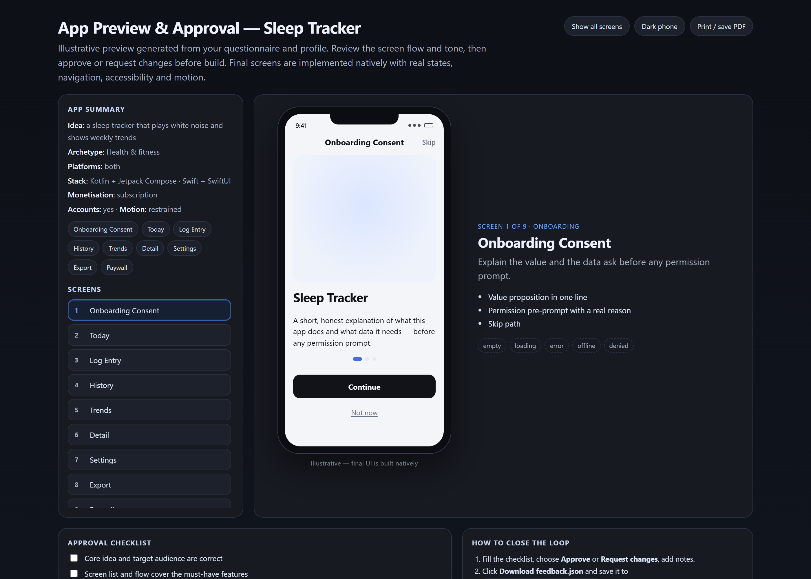

# Preview before code

[← back to the README](../README.md)

Phase P is a hard gate: no code is written until `00-approval.json` says `approved`. The preview is generated from the intake and profile — not hand-drawn — and shows the real screen inventory as illustrative phone mockups you can actually judge.

<div align="center">
  
</div>

It is a single self-contained HTML file — no server, no build:

- **16 screen kinds** rendered as plausible layouts (onboarding, auth, home, list, detail, form, settings, paywall, checkout, camera, map, chat, player, gallery, dashboard, confirmation), not grey boxes
- light/dark phone toggle, "show all screens", and print/save-to-PDF
- live controls for platform, monetisation and design direction — the profile re-routes and the preview follows
- add or remove screens and write change requests in the page itself
- an **approval checklist** that has to be filled before you can approve
- `feedback.json` export, so the decision is a file the next phase can read

```bash
node skills/mobile-app-factory/scripts/generate-preview.mjs --dir .mobile
# open .mobile/preview/index.html, fill the checklist, download feedback.json

node skills/mobile-app-factory/scripts/review-preview.mjs --dir .mobile \
  --from-feedback .mobile/preview/feedback.json

# or decide straight from the CLI
node skills/mobile-app-factory/scripts/review-preview.mjs --dir .mobile --approve
node skills/mobile-app-factory/scripts/review-preview.mjs --dir .mobile \
  --request-changes "Add settings, drop paywall" --add-screen settings --remove-screen paywall
```

Change requests update the intake **and** the profile, then regenerate the preview — so the profile and the thing you approved cannot drift apart. Every decision is appended to a history in `00-approval.json`.
